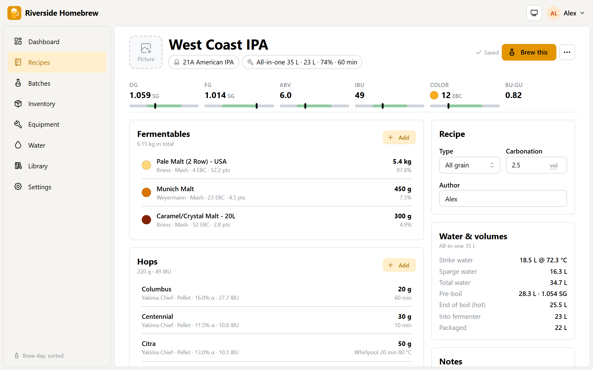
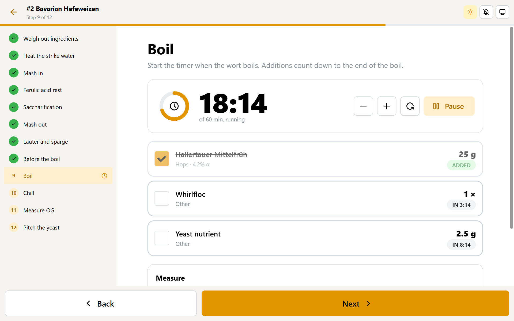
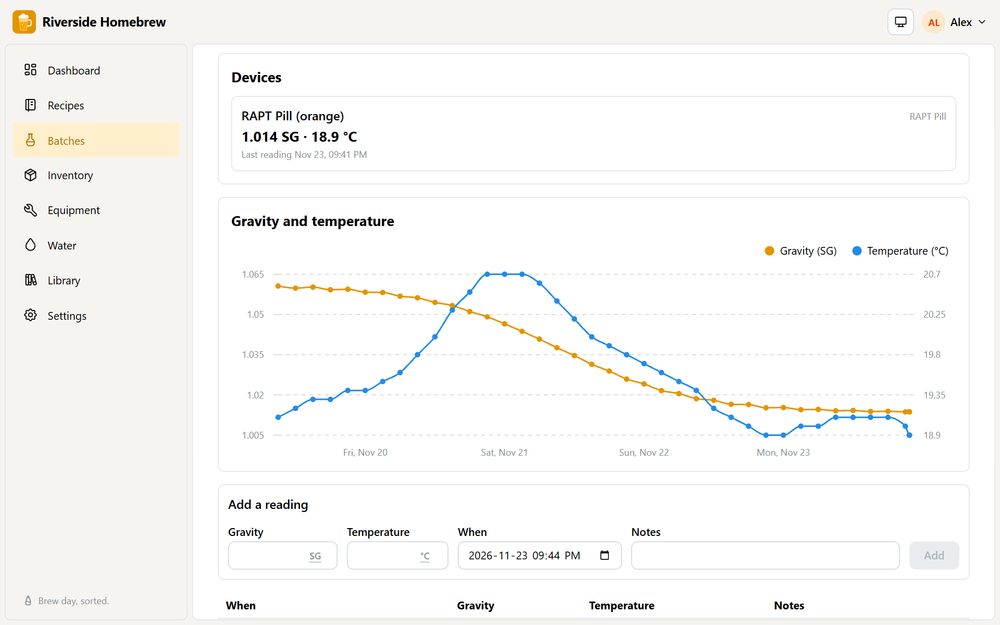
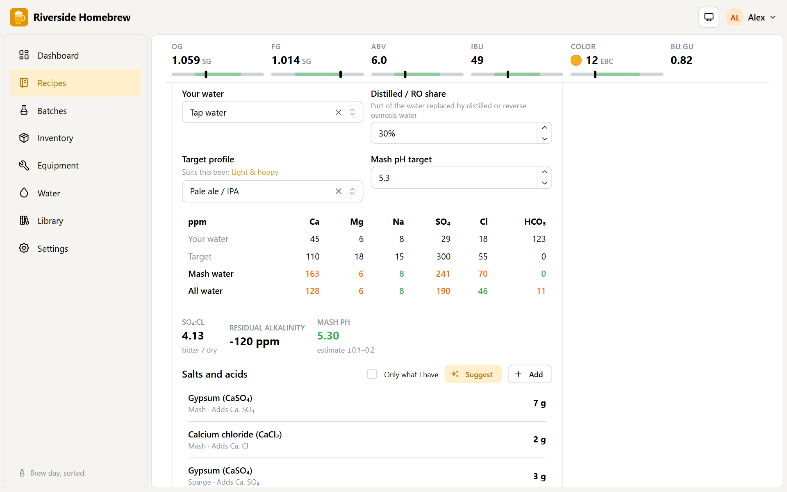
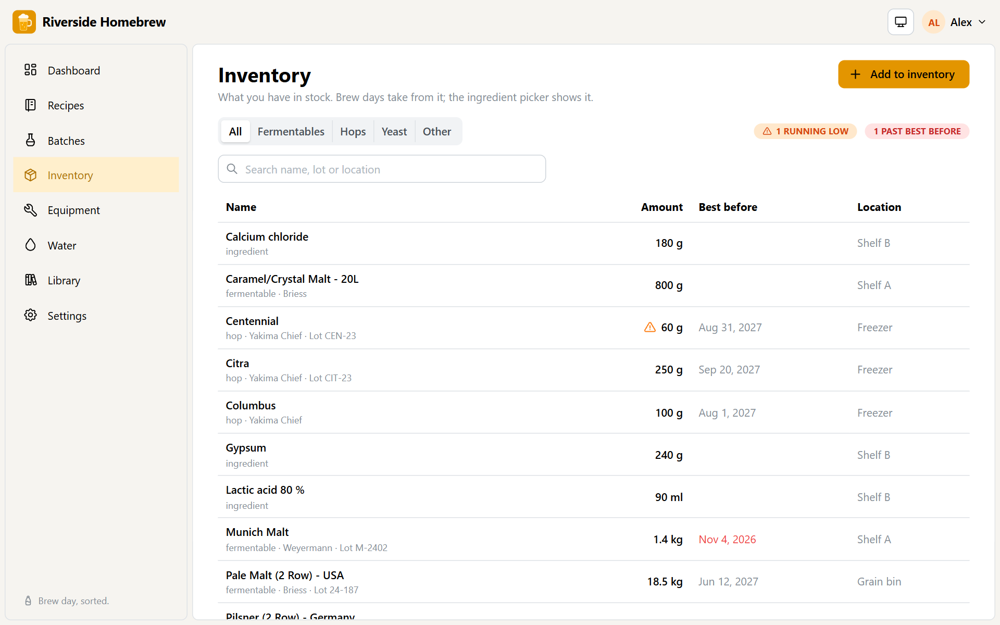
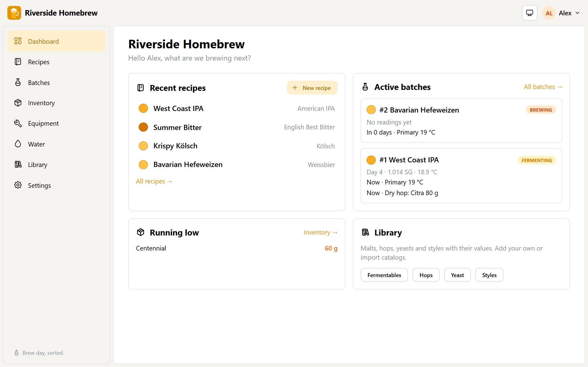
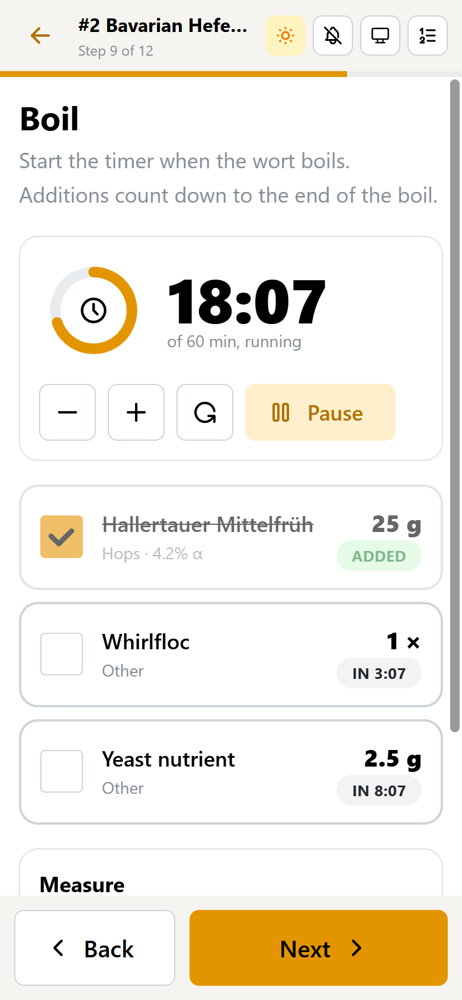

<h1>
  <picture>
    <source media="(prefers-color-scheme: dark)" srcset="docs/images/siduri-logo-dark.svg">
    
  </picture>
</h1>

**A self-hosted brewing app for your recipes, batches, inventory, equipment and water.** Named after Siduri, the alewife of the Epic of Gilgamesh, it keeps your brewery in one place.

Design recipes with live calculations, brew them step by step with timers on brew day, follow the fermentation with your RAPT Pill, iSpindel or Tilt, and always know what is in stock. Siduri runs as a single Docker container, keeps everything in one SQLite file, and needs nothing else.

<picture>
  <source media="(prefers-color-scheme: dark)" srcset="docs/images/screenshots/recipe-dark.png">
  
</picture>

> [!NOTE]
> **Siduri is built with AI.** Almost all of its code, tests and documentation were written by an AI coding assistant ([Claude Code](https://claude.com/claude-code)), directed by a human maintainer. Nothing here has been reviewed or audited by an independent professional. If that matters to you, read [how Siduri is made](docs/how-it-is-made.md) before you use it.

## Features

- 📖 **Recipe editor** with live OG, FG, ABV, IBU, colour and BU:GU, checked against the style; water and wort volumes for your equipment, with a warning when the mash, the boil or the batch doesn't fit
- 🍺 **Brew-day mode**: full screen, screen stays on, step by step from weighing out to pitching, with timers on the server that every device shows the same, and alerts for each addition
- 📈 **Fermentation** readings and chart, from your own measurements, a **RAPT Pill**, **RAPT chamber**, **iSpindel** or **Tilt**
- 🫧 **Carbonation**: priming sugar for bottles or a keg, or the pressure for force carbonation, from the beer's temperature and target CO₂
- 📦 **Inventory** with lots, best-before dates and low-stock warnings; a shopping list for each batch, and brew day takes the ingredients out of stock (with undo)
- 💧 **Water**: your water report, a target profile, suggested salts and acid for mash and sparge, and an estimated mash pH
- 📚 **Ingredient library** with producers and origins: about 100 malts, 54 hops, 188 yeasts, BJCP styles and water profiles, all editable
- 🤖 **Claude and other AI assistants** can look up and work with your brewery through [MCP](docs/mcp.md), with the rights you choose
- 🔄 **BeerXML and BeerJSON** import and export: recipes from Brewfather, BeerSmith, Brewtarget and others
- 💾 **Backup files**: download recipes, batches, inventory, equipment, your water profiles, library items and settings as one file, and import it on this or another server
- ⚖️ **Your units**: metric or US for each kind of value, switchable in every field, and shown the way you'd say them ("3 oz", "11 lb 6 oz", "250 ml")
- 📱 **Installable app** (PWA) for phone and desktop, with light and dark themes and live updates across devices

## Screenshots

| | |
|---|---|
|  |  |
| **Brew day**: step by step, with the boil timer and each addition counting down | **Fermentation**: readings from a RAPT Pill, attenuation and ABV so far |
|  |  |
| **Water**: salts and acid for the target profile, and the estimated mash pH | **Inventory**: lots, best-before dates and what runs low |
|  |  |
| **Dashboard**: what's brewing and fermenting, and what to buy | **On your phone**, next to the kettle |

## Quick start

You need Docker with Compose. Use the prebuilt image, or build it yourself from the source.

### Prebuilt image

Ready-made images for `linux/amd64` and `linux/arm64` (e.g. Raspberry Pi 4/5) are on the GitHub Container Registry as `ghcr.io/j-loewen/siduri`. The `latest` tag is always the newest release.

```sh
mkdir siduri && cd siduri
curl -fsSL -o .env https://raw.githubusercontent.com/j-loewen/siduri/main/.env.example
```

Create `docker-compose.yml` next to it:

```yaml
services:
  siduri:
    image: ghcr.io/j-loewen/siduri:latest
    container_name: siduri
    restart: unless-stopped
    ports:
      - "${SIDURI_PORT:-8087}:3000"
    volumes:
      - /etc/localtime:/etc/localtime:ro
      - ./data:/data
    env_file:
      - .env
```

```sh
docker compose up -d
```

To update later: `docker compose pull && docker compose up -d`.

### From source

```sh
git clone https://github.com/j-loewen/siduri.git siduri && cd siduri
cp .env.example .env
docker compose up -d --build
```

### Then

Open http://localhost:8087 and create your account. **The first account sets up the brewery.** Everyone who signs in later shares the same brewery.

Full instructions: [Installation](docs/installation.md).

## Documentation

| | |
|---|---|
| [Installation](docs/installation.md) | Setup, updates, running without Docker |
| [Configuration](docs/configuration.md) | All environment variables |
| [Backing up](docs/backups.md) | Backup files from the settings, full backups and restore |
| [Reverse proxy](docs/reverse-proxy.md) | HTTPS, Caddy, nginx, live updates |
| [User guide](docs/user-guide.md) | Recipes, batches, inventory, water, library, settings |
| [Brew day](docs/brew-day.md) | The brew-day mode step by step |
| [Smart devices](docs/devices.md) | RAPT Pill, RAPT chambers, iSpindel, Tilt and others |
| [Claude and AI assistants](docs/mcp.md) | Connecting Claude Code or Claude Desktop |
| [Development](docs/development.md) | Local setup, project layout, releases |
| [How Siduri is made](docs/how-it-is-made.md) | Built with AI: what that means for you |
| [Changelog](CHANGELOG.md) | What's in each version, and what to do when updating |

## Built with

TypeScript · React · [Mantine](https://mantine.dev) · [Fastify](https://fastify.dev) · SQLite with [Drizzle](https://orm.drizzle.team) · Docker · written with [Claude Code](https://claude.com/claude-code)

```sh
npm install && npm run dev    # API on :3000, web app on :5173
```

See [Development](docs/development.md).

Ingredient and style data from [common-beer-data](https://github.com/Wall-Brew-Co/common-beer-data) by Wall Brew Co, BeerJSON schemas from [beerjson](https://github.com/beerjson/beerjson) (both MIT).

## License

Siduri is free software under the [GNU Affero General Public License v3.0](LICENSE) or later. You may use, change and share it. If you run a changed version for others, for example as a website, you have to offer them its source code too.
